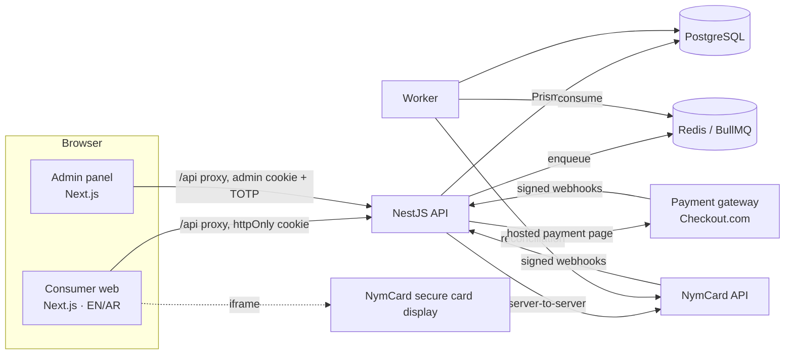

# OnlinePay

Consumer virtual cards for the UAE. People sign up, verify their identity, buy a bundle of
**30 virtual cards for 30 AED (+5% VAT)**, and then create, label, fund, freeze and cancel
cards from a bilingual (English / Arabic) dashboard. Cards are issued through **NymCard**.

> **Status:** Pre-production scaffold. Everything runs locally against **mock** NymCard, payment
> gateway and KYC providers. Before sandbox/production, work through the
> `TODO(nymcard-docs)` items in [docs/NYMCARD_INTEGRATION.md](docs/NYMCARD_INTEGRATION.md) and the
> legal review items in [docs/COMPLIANCE.md](docs/COMPLIANCE.md).

## Architecture



| Path              | What it is                                                                          |
| ----------------- | ----------------------------------------------------------------------------------- |
| `apps/web`        | Consumer site and dashboard (Next.js App Router, `next-intl`, Tailwind, RTL)        |
| `apps/admin`      | Internal admin panel: users, KYC queue, cards, refunds, monitoring, disputes, audit |
| `apps/api`        | NestJS API (`src/main.ts`) **and** BullMQ worker (`src/worker.ts`)                  |
| `packages/db`     | Prisma schema, migrations, seed                                                     |
| `packages/shared` | Money (integer fils), VAT, card state machine, bundle quota, redaction, Zod schemas |
| `docs/`           | Architecture, decisions, NymCard integration, compliance                            |

Key properties:

- **No card data on our servers.** PAN/CVV are only ever shown in NymCard's hosted secure-display iframe. Logs are redacted.
- **Hosted payment page.** Card/Apple Pay/Google Pay entry happens on the gateway's page (PCI SAQ-A scope).
- **Money is integer fils.** No floats anywhere. Wallet uses an append-only, idempotent ledger.
- **Webhook inbox.** Every webhook is signature-checked, stored once (idempotent by provider event id), acknowledged, then processed by the worker with retries.
- **Idempotency keys** on every money/card-moving endpoint; **audit log** for every card, money, KYC and admin action.

## Quick start

Requirements: Node 22, pnpm 10 (`corepack enable`), Docker.

**Fastest:** `./scripts/setup.sh --push` does everything below, runs typecheck + tests, and commits
the lockfile and initial migration. Or step by step:

```bash
cp .env.example .env                 # then set SEED_ADMIN_PASSWORD (12+ chars)
ln -sf ../../.env packages/db/.env   # Prisma CLI reads .env next to the schema package
pnpm install
docker compose up -d                 # postgres, redis, mailpit
pnpm db:generate
pnpm db:migrate                      # creates the initial migration on first run
pnpm db:seed                         # demo user + admin (prints admin TOTP secret once)
pnpm dev                             # web :3000, admin :3001, api :4000, worker
```

- Consumer site: http://localhost:3000 (Arabic: http://localhost:3000/ar)
- Admin: http://localhost:3001 (seeded admin email + `SEED_ADMIN_PASSWORD` + TOTP from the seed output)
- API docs (dev only): http://localhost:4000/docs
- Emails **and dev SMS codes**: http://localhost:8025 (Mailpit)

Demo login: `demo@onlinepay.local` — the SMS code appears in Mailpit and the API log.

### Trying the full flow locally

1. Sign up → read both codes in Mailpit → verify.
2. KYC: mock provider auto-approves (`KYC_MOCK_AUTO_APPROVE=true`); set it to `false` to approve from the admin KYC queue.
3. Buy the bundle → mock payment page → "Pay". The webhook is processed by the worker and the bundle appears.
4. Top up the wallet, create a card, add money, reveal (shows a fake mock card), freeze, cancel.
5. On a card page, "Simulate a test purchase" sends signed-style NymCard events through the real webhook pipeline.

## Scripts

| Command                                                     |                                                |
| ----------------------------------------------------------- | ---------------------------------------------- |
| `pnpm dev`                                                  | All apps in watch mode                         |
| `pnpm build` / `pnpm typecheck` / `pnpm lint` / `pnpm test` | Across the monorepo (Turborepo)                |
| `pnpm e2e`                                                  | Playwright core flow (needs the stack running) |
| `pnpm db:migrate` / `db:deploy` / `db:seed`                 | Prisma                                         |

## Configuration

All settings live in `.env` (see `.env.example` for every variable). The important switches:

| Variable                               | Values                              | Notes                                                    |
| -------------------------------------- | ----------------------------------- | -------------------------------------------------------- |
| `NYMCARD_MODE`                         | `mock` \| `sandbox` \| `production` | Mock state is kept in Redis                              |
| `PAYMENT_GATEWAY`                      | `mock` \| `checkoutcom`             |                                                          |
| `KYC_PROVIDER`                         | `mock`                              | Add a real adapter in `apps/api/src/kyc/kyc.provider.ts` |
| `BUNDLE_MODE`                          | `one_time` \| `subscription`        | Subscription is not implemented yet                      |
| `CANCELLED_CARDS_COUNT_AGAINST_BUNDLE` | `true` \| `false`                   |                                                          |
| `CANCELLED_CARD_BALANCE_DESTINATION`   | `wallet` \| `source`                | `source` not implemented yet                             |

The API refuses to start in `NODE_ENV=production` with any mock provider or without secure cookies.

## Deployment notes

- Run `apps/api` as two processes from the same build: `node dist/main.js` (HTTP) and `node dist/worker.js` (jobs).
- Put the web app and API behind the same site (e.g. `app.onlinepay.ae` + `/api` proxy) so cookies stay first-party.
- Managed Postgres + Redis in the UAE region; secrets from a secrets manager; TLS everywhere.
- Register webhook URLs: `POST /webhooks/nymcard`, `POST /webhooks/payments/checkoutcom`.
- Restrict the admin app by IP/VPN/SSO in addition to password + TOTP.

## Docs

- [Architecture](docs/ARCHITECTURE.md)
- [Decisions (pending founder confirmation)](docs/DECISIONS.md)
- [NymCard integration checklist](docs/NYMCARD_INTEGRATION.md)
- [Compliance & security notes](docs/COMPLIANCE.md)

## License

Proprietary — all rights reserved.
